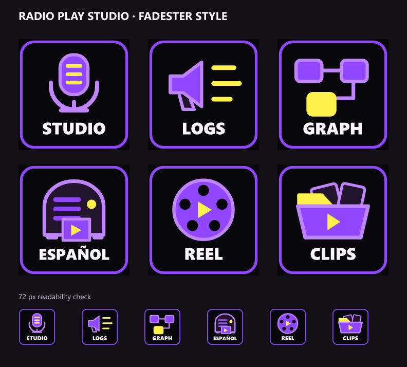

# Key art for the keys beside the plugin

Six static faces for the launcher and media keys that sit next to Radio Play Studio's own
actions in a demo layout. The plugin's MAKE key, Machine control and four dials draw
themselves live (progress, picks, percent), so they are not here and need no art.



| Face | Label | Put it on |
|---|---|---|
| `studio` | STUDIO | a **Website** key: `http://127.0.0.1:8765/` |
| `logblaster` | LOGS | a **Website** key: `http://127.0.0.1:8188/logblaster` |
| `comfyui` | GRAPH | a **Website** key: `http://127.0.0.1:8188/` |
| `spanish` | ESPAÑOL | an **Open** key on a Spanish-language episode |
| `reel` | REEL | an **Open** key on a highlight reel |
| `clips` | CLIPS | an **Open** key on your clips folder |

Website and Open are the Stream Deck app's own actions (under *System*), so the plugin
package does not carry these images; take them from here.

## Put one on a key

1. In the Stream Deck app, drag **Website** or **Open** onto a key and set its address or file.
2. Click the key image in the action's settings, choose **Set from File**, and pick the PNG:
   `key120/` for a Stream Deck +, `key72/` for a Stream Deck MK.2, XL, Mini or Neo.
3. Clear the action's **Title** (or untick *Show Title*). The label is already in the art,
   and a title on top would print it twice.

## Files

- `svg/` -- the editable masters, 120 x 120 viewBox.
- `png/` -- 1024 px masters.
- `key120/`, `key72/` -- the two key sizes.
- `preview.png`, `preview.svg` -- all six, with a 72 px readability row.

## Change them

The faces are drawn in [`../scripts/key-art.ts`](../scripts/key-art.ts). Edit a glyph there,
then from `contest/radio-play-studio/streamdeck`:

```bash
npm run key-art
```

That rewrites everything in this folder. `tests/key-art.test.ts` fails when the committed
SVGs no longer match the module, so commit the regenerated files with the edit. Render on
Windows: the labels are Segoe UI, like the plugin's own faces.

The palette -- black `#08070B`, purple `#9146FF`, lavender `#C084FC`, yellow `#FFF04B`,
white `#FAF7FF`, panel `#24152F` -- follows
[streamdeck-fadester](https://github.com/jbrick2070/streamdeck-fadester) at
`7cf72073e1a5498b4d756d7a47d24785acbd5b79`. The glyphs are original; no Fadester code or art
is copied. MIT, like the rest of this repository.
