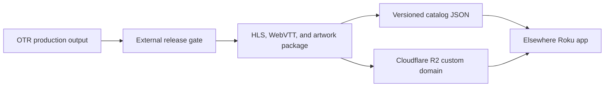

# Elsewhere Broadcasting Service: Roku MVP Scope

**Status:** scoped for a public beta, not yet implemented.

**Working public name:** Elsewhere Broadcasting Service (EBS). "Elsewhere" is
the short form used in the app. This is a working name until it has passed a
trademark and domain-clearance check.

## Product decision

Elsewhere is a free Roku app for browsing original visual audio dramas:
short films made to be heard as much as watched. The public experience is a
new broadcast service with shows, episodes, atmosphere, and a reason to come
back. ComfyUI-OldTimeRadio remains the production tool behind the catalog; it
is not the public product name or store promise.

The first release proves one thing: a person can find Elsewhere in Roku's
Streaming Store, install it, browse a real catalog, and play an episode
reliably with a Roku remote.

## V1 boundaries

V1 includes:

- A public, free Roku Streaming Store app under the EBS brand.
- Eight to twelve curated pilot episodes, each no longer than 15 minutes.
- Home rows for Start Here, Latest Transmissions, and Shows.
- A show page with artwork, premise, and episode list.
- An episode page with a synopsis, runtime, age/content information, and Play.
- HLS video playback with pause, seek, replay, loading, and useful failure
  states.
- Per-device watch state: an episode bookmark plus the ordering/completion
  state needed for series deep links to choose the right next episode, without
  accounts or cross-device watch history.
- WebVTT captions that honor Roku's global caption settings and player options
  for On, Off, On instant replay, and On mute on Roku TVs.
- A versioned remote catalog so a new episode can be released without an app
  package update.
- English metadata and captions for the pilot, with catalog fields that can
  later support other languages.
- Roku beta testing, then a public certification submission.

V1 does not include accounts, subscriptions, advertising, payments, social
features, downloads, a 24-hour live stream, cross-device watch history, or
automatic publication from a local render directory. Those are real product
work and should not be allowed to hide inside the first browse-and-play launch.

Short-form is deliberate. Keeping every pilot episode at 15 minutes or less
avoids the 30-day bookmark and trick-play-thumbnail requirements Roku applies
to longer VOD content. It does not remove episodic deep-link behavior: episode
links still need local resume and series links need a local smart-bookmark
decision. The rule must be checked again against Roku's current certification
criteria immediately before submission.

## The viewer experience

The home screen should feel like arriving at a service, not opening a file
browser.

1. **Start Here** introduces the strongest one or two episodes.
2. **Latest Transmissions** makes each release easy to find.
3. **Shows** groups episodes by recurring series, rather than exposing OTR
   production banks or internal render labels.
4. **Show detail** gives a visual identity, a short premise, and all episodes
   in order.
5. **Episode detail** makes the play decision easy: title, short description,
   runtime, release date, rating/content information, captions, and Play.
6. **Player** uses standard Roku behavior: remote transport controls, back
   navigation, and a clear retry path when delivery fails.

The store listing is part of the product. It needs an EBS icon, a 540x405
store poster, a plain-language description, publisher identity, support URL,
support email and phone number, privacy policy, terms, and non-transparent
FHD and HD splash artwork. A Roku Search feed can follow the public launch to
make individual shows and episodes discoverable beyond the app listing.

## Delivery architecture



The app is a standard BrightScript and SceneGraph package. A SceneGraph Task
downloads the catalog over HTTPS, maps it into Roku ContentNodes, and the Roku
Video node plays each episode's HLS master playlist. The app caches the last
known good catalog for a graceful recovery when the catalog request fails.

The production host is Cloudflare R2 behind a custom domain owned by EBS. The
managed `r2.dev` endpoint is for development and is rate-limited, so it is not
the production media URL.

Use immutable release objects and publish the catalog last:

```text
https://media.<approved-domain>/catalog/v1.json
https://media.<approved-domain>/episodes/<episode-id>/<release-id>/master.m3u8
https://media.<approved-domain>/episodes/<episode-id>/<release-id>/captions.en.vtt
https://media.<approved-domain>/artwork/<content-hash>.jpg
```

Episode video is packaged as HLS with H.264 video and AAC audio. Start with
4-6 second segments and test the actual package on the Roku certification
devices. The current OTR finals are useful H.264/AAC 1080p source masters, but
source compatibility is not a substitute for a real Roku playback test. WebVTT
caption tracks are a pilot deliverable and must remain synchronized with the
audio; burned-in captions alone do not give the viewer a caption control.

Each release uploads immutable media, captions, and artwork first. It is
smoke-tested through the public media URL. Only then does the catalog advance
to a new revision. If a catalog release is bad, restoring the prior catalog
revision rolls it back without touching media objects or the Roku package.

## Catalog and release contract

The catalog is an external, versioned product contract. It is not an export of
an OTR work directory. At minimum, it needs stable internal show and episode
IDs; a stable episode `contentId` used for both Roku `episode` and `series`
deep-link requests; media type; series order; title; show ID; episode number;
synopsis; runtime in seconds; release date; genres; rating/content information;
artwork URL; HLS URL; caption tracks; and an availability state. The internal
show ID is for browsing, not a separate Roku Search key. IDs never derive from
a changing filename. The ordering is an explicit product field, not an
inference from publication date or a title string.

Every public catalog entry must have a separate release record containing:

- The exact OTR episode ID and final source-path identity.
- A valid `meta.publication_eligibility` receipt whose episode ID matches the
  source episode and whose decision is eligible.
- Media QA evidence: real Roku playback, timing, audio, video, caption
  synchronization/settings, metadata, and all deep-link behaviors.
- An explicit curator approval with reviewer and date.
- The HLS package revision and content hashes used in the catalog.

This gate is essential. `otr/obs` is the operator's proof that a render
completed, and it intentionally receives every completed episode even when its
rights receipt did not clear. The existing eligibility receipt also records
what OTR knows about its source; it is necessary evidence, not a replacement
for the final external-release review.

Nothing in V1 scans `otr/obs` or the 2,598 episode workspaces for upload. A
curator selects a candidate, validates its durable ledger, packages it for
delivery, and approves the resulting release record. Automation can come only
after this contract has proven itself with the pilot.

## Certification and operating requirements

Build certification behavior into the first package:

- Use a private Roku beta before public submission. Roku currently allows up
  to 20 beta testers for 120 days.
- Target Roku's documented performance ceiling: app launch within 15 seconds,
  screen transitions within 3 seconds, remote response within 250 ms, and
  playback start within 8 seconds.
- Add Roku's required launch-timing beacon and show an in-app loading indicator
  whenever a visible operation takes longer than 3 seconds.
- Keep the package under Roku's 4 MB package limit by fetching media and
  catalog data at runtime.
- Implement normal Back behavior and Direct to Play. Episode deep links launch
  straight into playback at the local bookmarked position; series deep links
  use a local smart bookmark to choose the correct episode and position.
- Handle deep links on cold launch and while the app is running, fall back to
  Home for an invalid request, and supply Roku's certification samples for
  every media type the catalog declares.
- Support the Roku instant-replay behavior of rewinding 10-25 seconds.
- Test the beta on multiple Roku models, including the Streaming Stick+ 3810X
  and Premiere+ 3921X named in Roku's current certification criteria, or the
  exact successors Roku specifies when the app is submitted.
- Pass Roku Static Analysis and App Behavior Analysis before scheduling public
  certification.
- Recheck Roku's certification criteria, media specification, and deep-link
  rules before beta and again before public submission; these policies change.

Roku's current documentation says catalog/content changes can be delivered
without recertifying the app, while app-code changes require a new package
submission. That is why content is separated from the app package.

## Cost boundary

The recommended stack keeps infrastructure inexpensive:

- Roku developer enrollment is free; public store publication requires review
  and certification.
- Cloudflare R2 currently includes 10 GB-month of standard storage, 1 million
  Class A operations, 10 million Class B operations, and no egress charge.
- Storage beyond the free allowance is currently $0.015 per GB-month; a domain
  is the expected fixed cost outside R2.

The 8-12 episode pilot must stay within the current 10 GB free storage
allowance. Recheck pricing and service terms before creating the account or
raising the catalog size.

## Ownership and launch gates

Before implementation begins, settle these four items:

1. **Brand:** clear Elsewhere Broadcasting Service and choose the final public
   name, icon direction, and owned domain.
2. **Publisher identity:** create or use a Roku developer account owned by the
   organization that owns the service and its content, not a contractor's
   account.
3. **Pilot slate:** choose 8-12 rights-cleared, externally approved episodes
   under 15 minutes, plus their final copy and artwork.
4. **Launch territory:** decide the first Streaming Store region and ensure
   that each pilot episode is cleared for that territory.

The Roku app source should live in a separate EBS delivery repository when
implementation begins. It has a different release cycle and public runtime
than the ComfyUI node package. This OTR repository owns the production and
release-evidence side of the boundary; it does not turn into the Roku package.

## Delivery sequence

1. Lock the working brand and the owned domain.
2. Define the release-record JSON schema and curate the initial pilot slate.
3. Package one approved episode as HLS plus WebVTT, host it, and prove it on a
   physical Roku device.
4. Build the SceneGraph browse-and-play shell against a fixture catalog.
5. Connect it to the production catalog, add Direct to Play, episode and
   series deep linking, local bookmarks, and test beta installs across the
   target Roku devices.
6. Create the store materials, support/privacy pages, and certification
   evidence; submit the public app.
7. Add a Roku Search feed after the public listing is live and stable.

## Sources to recheck before implementation

- [Roku app publishing guide](https://developer.roku.com/dev/docs/channel-publishing-guide)
- [Roku certification criteria](https://developer.roku.com/dev/docs/certification)
- [Roku content feed guide](https://developer.roku.com/dev/docs/content-feed)
- [Roku streaming specifications](https://developer.roku.com/dev/docs/media)
- [Roku deep linking](https://developer.roku.com/dev/docs/implementing-deep-linking)
- [Cloudflare R2 pricing](https://developers.cloudflare.com/r2/pricing/)
- [Cloudflare R2 public-bucket guidance](https://developers.cloudflare.com/r2/buckets/public-buckets/)
